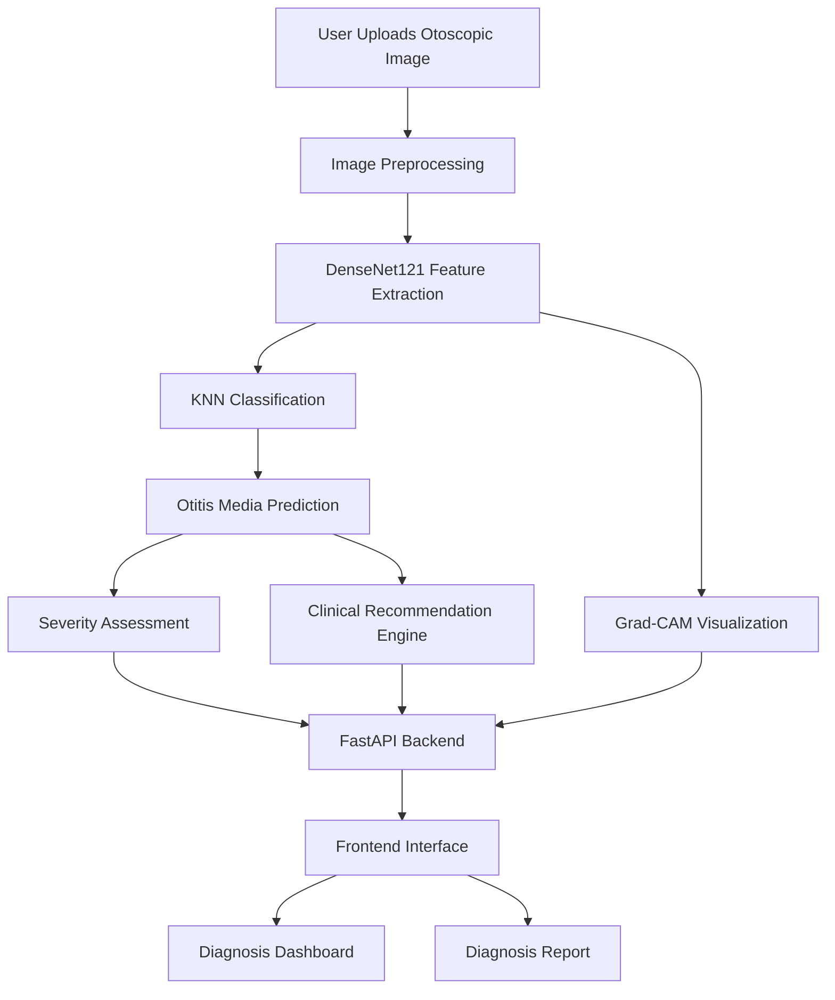
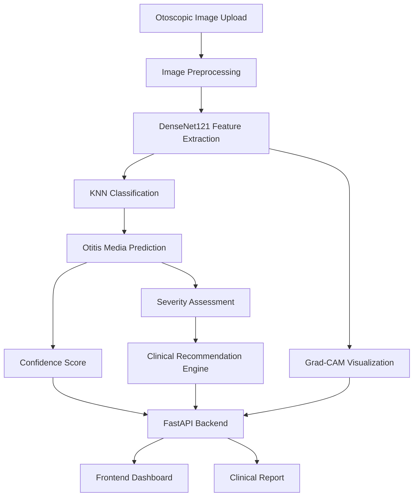

# OtitisAI-CDSS 🩺

## AI-Based Automated Otitis Media Diagnosis and Clinical Decision Support System

**OtitisAI-CDSS** is an AI-powered clinical decision support system designed to assist in the analysis and classification of **Otitis Media using otoscopic images**. The system combines deep learning-based feature extraction, machine learning classification, Explainable AI, and a web-based interface to provide an end-to-end diagnostic support workflow.

> **Note:** This project is developed for academic and research purposes and is not intended to replace professional medical diagnosis or clinical decision-making.

---

##  Project Overview

Otitis Media is a common ear condition that can be identified through examination of the tympanic membrane using an otoscope. This project aims to assist in the analysis of otoscopic images using **Computer Vision and Machine Learning techniques**.

The system extracts meaningful visual features from uploaded otoscopic images using **DenseNet121** and performs classification using a **K-Nearest Neighbors (KNN)** model.

The prediction is presented through a responsive web application along with confidence information, severity assessment, clinical recommendations, and Explainable AI visualization using **Grad-CAM**.

---

## 🏗️ System Architecture

The following diagram illustrates the workflow of OtitisAI-CDSS, from otoscopic image upload to AI-based prediction, clinical recommendations, visualization, and report generation.


    
---

##  Key Features

* 🖼️ Otoscopic image upload and analysis
* 🧠 DenseNet121-based deep feature extraction
* 🤖 KNN-based image classification
* 📊 Diagnosis confidence scoring
* 🩺 Severity assessment
* 💡 Symptom-based clinical recommendations
* 🔍 Grad-CAM-based Explainable AI visualization
* 📋 Diagnosis history tracking
* 📈 Interactive clinical dashboard
* 📄 Automated diagnosis report generation
* 🌐 FastAPI-based backend
* 💻 Responsive web interface

---
## 🧠 AI/ML Workflow

OtitisAI-CDSS follows a hybrid Deep Learning and Machine Learning approach to analyze otoscopic images and generate clinical decision support results.



### Workflow Explanation

1. **Image Upload:** User uploads an otoscopic image through the web interface.
2. **Image Preprocessing:** The image is prepared for model analysis.
3. **Feature Extraction:** DenseNet121 extracts meaningful visual features.
4. **Classification:** K-Nearest Neighbors (KNN) classifies the extracted features.
5. **Prediction:** The system generates a predicted class and confidence score.
6. **Severity Assessment:** The system evaluates the predicted condition's severity.
7. **Clinical Recommendations:** Recommendations are generated using the available prediction and symptom information.
8. **Grad-CAM Visualization:** Highlights relevant image regions using the DenseNet121 model.
9. **Result Presentation:** FastAPI connects the backend results to the frontend dashboard and clinical report.


---

## 🛠️ Technologies Used

| Category | Technologies |
|---|---|
| Programming Language | Python |
| Deep Learning | TensorFlow, DenseNet121 |
| Machine Learning | K-Nearest Neighbors (KNN) |
| Computer Vision | OpenCV, Grad-CAM |
| Backend | FastAPI, REST API |
| Frontend | HTML5, CSS3, JavaScript |
| Data Processing | NumPy |
| Development Tools | Git, GitHub, VS Code |

---

## 📂 Project Structure

```text
OtitisAI-CDSS/
│
├── backend/
│   ├── main.py
│   ├── predictor.py
│   ├── recommendation_engine.py
│   ├── severity_engine.py
│   ├── gradcam.py
│   ├── gradcam_visualization.py
│   ├── train_knn.py
│   └── model/
│
├── frontend/
│   ├── index.html
│   ├── app.html
│   ├── dashboard.html
│   ├── report.html
│   ├── app.js
│   ├── dashboard.js
│   ├── report.js
│   └── CSS/
│
├── data/
├── trained_models/
├── training/
│
└── .gitignore
```

### Main Components

- **backend/** – Handles prediction, feature extraction, severity assessment, and recommendations.
- **frontend/** – Contains the user interface, dashboard, and report pages.
- **data/** – Stores project data.
- **trained_models/** – Contains trained model artifacts.
- **training/** – Contains model training-related resources.
---

##  System Modules

### 1. Image Analysis

The user uploads an otoscopic image through the web interface. The image is preprocessed before being passed to the deep learning feature extractor.

### 2. Feature Extraction

**DenseNet121** is used to extract high-level visual features from the otoscopic image.

### 3. Classification

The extracted features are passed to a **K-Nearest Neighbors (KNN)** classifier to determine the predicted diagnostic class.

### 4. Severity Assessment

The system provides a severity assessment based on the available prediction and clinical information.

### 5. Clinical Recommendations

The recommendation engine generates relevant guidance based on the predicted condition and entered symptoms.

### 6. Explainable AI

**Grad-CAM** is integrated to generate a visual heatmap highlighting regions of the image associated with the DenseNet121 feature representation.

### 7. Dashboard

The dashboard provides:

* Total diagnoses
* Average confidence
* Common diagnosis
* Low-confidence predictions
* Diagnosis history
* Detailed diagnosis information

### 8. Clinical Report

The reporting module presents the diagnosis, confidence, severity, symptoms, recommendations, precautions, and visual evidence in a structured report format.

---

## ⚙️ Installation & Setup

Follow these steps to run OtitisAI-CDSS locally.

### Prerequisites

- Python 3.11 or above
- Git
- Web browser
- pip package manager

### Step 1: Clone the Repository

```bash
git clone https://github.com/NelluriVarsha/otitis-ai-cdss.git
```

### Step 2: Navigate to the Project

```bash
cd otitis-ai-cdss
```

### Step 3: Set Up the Python Environment

```bash
python -m venv venv
```

Activate the environment:

**Windows:**
```bash
venv\Scripts\activate
```

**Linux / macOS:**
```bash
source venv/bin/activate
```

### Step 4: Install Dependencies

Install the dependencies listed in your requirements file:

```bash
pip install -r requirements.txt
```

### Step 5: Start the Backend

```bash
cd backend
python -m uvicorn main:app --reload --port 8000
```

Backend API:

```text
http://127.0.0.1:8000
```

### Step 6: Start the Frontend

Open another terminal and navigate to the frontend folder:

```bash
cd frontend
python -m http.server 5500
```

Open the application:

```text
http://127.0.0.1:5500/index.html
```

The OtitisAI-CDSS application should now be accessible locally.

---

##  Application Workflow

1. Open the OtitisAI-CDSS web application.
2. Navigate to the **Diagnosis** page.
3. Upload an otoscopic image.
4. Enter patient-related symptoms and information.
5. Submit the diagnosis request.
6. The backend processes the image.
7. DenseNet121 extracts visual features.
8. KNN predicts the diagnostic class.
9. The system calculates confidence and severity.
10. Clinical recommendations are generated.
11. Grad-CAM produces an explainability visualization.
12. The result is stored in diagnosis history.
13. The user can view the result through the dashboard or generate a report.

---

##  Dashboard

The system includes an interactive dashboard that provides an overview of previous diagnosis results.

It displays:

* Total number of diagnoses
* Average prediction confidence
* Commonly predicted diagnosis
* Low-confidence predictions
* Searchable diagnosis history
* Detailed diagnosis information

---

## 🔍 Explainable AI

OtitisAI-CDSS integrates Grad-CAM (Gradient-weighted Class Activation Mapping) to generate visual heatmaps highlighting relevant regions in otoscopic images.

The visualization is associated with the DenseNet121 feature extraction network and helps users inspect image regions considered by the deep learning component.

Grad-CAM provides visual interpretability and does not independently validate the final KNN classification.

---

##  Clinical Report

The report module provides a structured summary containing:

* Patient information
* Uploaded image information
* Predicted diagnosis
* Confidence score
* Severity
* Symptoms
* Clinical recommendations
* Precautions
* When-to-seek-care guidance
* Grad-CAM visual evidence

---

##  Model Evaluation

The model is evaluated using the following performance metrics:

- Accuracy
- Precision
- Recall
- F1-score
- Confusion Matrix

---

##  Future Enhancements

Future versions of OtitisAI-CDSS could include:

* Larger and more diverse otoscopic image datasets
* Advanced CNN and Vision Transformer architectures
* Improved model validation and performance evaluation
* Multi-model ensemble learning
* Real-time clinical decision support
* Secure patient data management
* Cloud deployment
* Doctor authentication and role-based access
* Integration with electronic health records
* Enhanced medical image segmentation
* More advanced Explainable AI techniques

---

##  Applications

The system can be explored for:

* Academic research
* Medical AI research
* Otoscopic image analysis
* Computer Vision applications
* Explainable AI research
* Clinical decision-support prototypes
* Healthcare technology demonstrations

---

##  Disclaimer

OtitisAI-CDSS is an **academic/research prototype**. The predictions and recommendations generated by this system should not be considered a substitute for examination, diagnosis, or treatment by a qualified healthcare professional.

